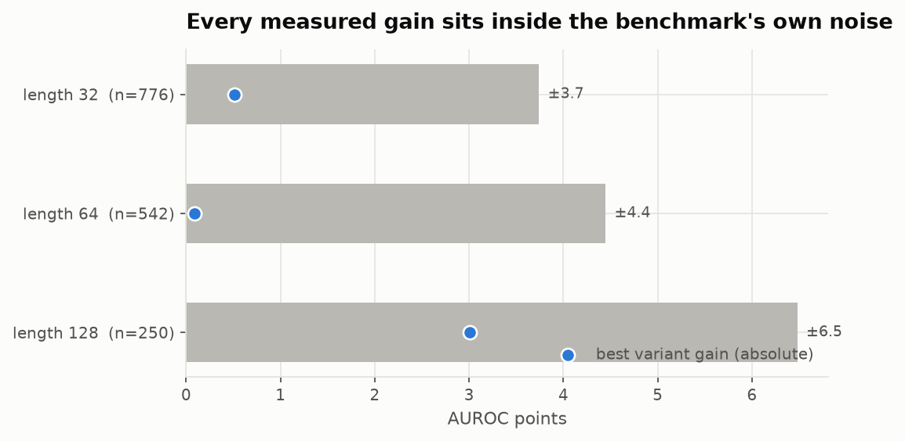
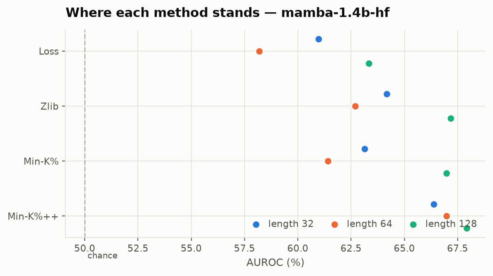
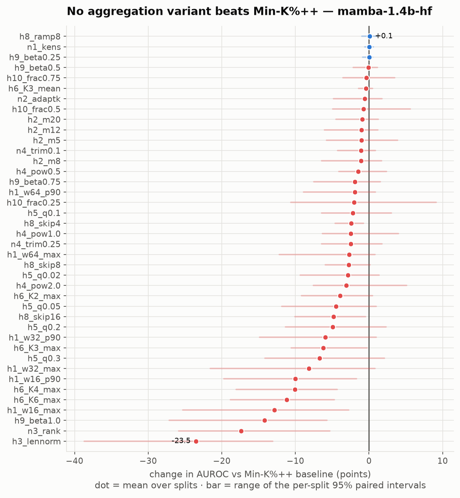
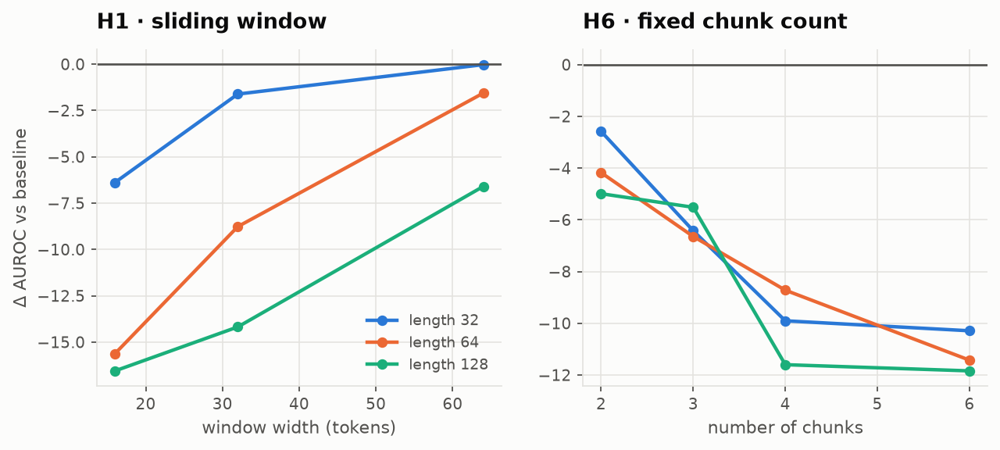
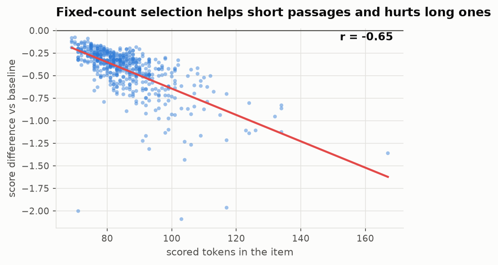
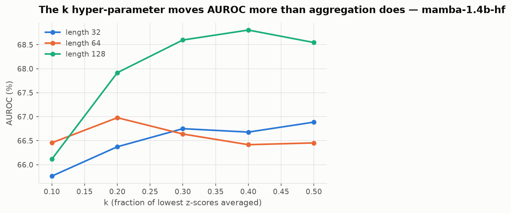

# Testing the ten improvement hypotheses for Min-K%++

**Project:** S08 · Sofiia Bakina · Min-K%++ (Zhang et al., ICLR 2025)
**Question:** does the *aggregation* step of Min-K%++ — how per-token z-scores combine
into one score for a passage — hold any remaining headroom?

**Answer: no. Of 120 paired comparisons on the paper's own target model, not one beats the
baseline and 53 are significantly worse.** The failures follow a single mechanism, and
that mechanism is specific enough to predict its own exceptions.

Two models were run. **Mamba-1.4B** is the primary: it is the column of Table 1 this
project reproduces, and the reproduction is near-exact (§3). `pythia-160m` is a
sensitivity check, and it became a result of its own (§7).

Every number below is regenerated by the commands in [`README.md`](README.md).

---

## 1. Verdict table — Mamba-1.4B, 120 comparisons

| # | Hypothesis | Verdict | Best Δ | Worst Δ | Significantly worse |
|---|---|---|---:|---:|---:|
| **H1** | Sliding window, max pooling | **Refuted** | −0.0 | **−16.6** | 10 of 18 |
| **H2** | Fixed-count selection | **Null** | −0.1 | −2.6 | 0 of 12 |
| **H3** | Length-normalised aggregation | **Refuted, catastrophically** | −18.8 | **−28.6** | 3 of 3 |
| **H4** | Magnitude weighting | **Refuted** | −0.9 | −4.7 | 3 of 9 |
| **H5** | Order statistic | **Refuted** | −1.0 | −9.1 | 7 of 15 |
| **H6** | Chunk and vote | **Refuted** | −0.3 | −11.8 | 11 of 15 |
| **H7** | Length-conditional calibration | **Not applicable to AUROC** | — | — | — |
| **H8** | Position weighting | **Refuted** | +0.3 | −7.4 | 7 of 12 |
| **H9** | Two-sided aggregation | **Refuted** | +0.3 | −17.8 | 3 of 12 |
| **H10** | Prefix / early stop | **Null for accuracy; useful for compute** | +3.0 | −6.3 | 1 of 9 |
| **N1** | k-ensemble *(new)* | **Null** | +0.2 | −0.1 | 0 of 3 |
| **N2** | Length-adaptive k *(new)* | **Null** | +0.4 | −1.6 | 0 of 3 |
| **N3** | Rank-normalised *(new)* | **Refuted, instructively** | −15.1 | −19.3 | 3 of 3 |
| **N4** | Trimmed tail *(new)* | **Null to negative** | −0.5 | −3.9 | 1 of 6 |

**Zero hypotheses produced a significant improvement at any length.** The families that
are merely null (H2, N1, N2) are null everywhere, not mixed.

---

## 2. What makes the comparison trustworthy

**Matched compute by construction.** The model runs once per split; three numbers are
cached per token (`logp`, `mu`, `sigma`). Every variant is a different function of the
same array, so no variant can be advantaged by a different forward pass.

**Self-checks that must pass before any run.** Nine assertions, each guarding a specific
way of producing plausible-but-wrong numbers. The one that matters most: `z` must not
collapse onto `logp` — dropping `sigma` silently turns Min-K%++ back into Min-K% while
every number still looks reasonable.

**The right baseline.** Every variant here operates on z-scores, so each is a Min-K%++
variant. Compared against *Min-K%* several would appear to gain — but that gain is the
z-standardisation, which is Min-K%++'s own contribution. The comparison baseline is
hard-coded to `minkpp_0.2`.

**Measured, not assumed, resolution.** Paired bootstrap, 2000 resamples, shared indices:

| Split | n | 95% half-width on a single AUROC |
|---|---:|---:|
| length32 | 776 | ±3.7 |
| length64 | 542 | ±4.5 |
| length128 | 250 | ±6.5 |

---

## 3. The baseline reproduces to ±0.2

Independent re-implementation, CPU, float32, against the published Mamba-1.4B column of
Table 1. Min-K% and Min-K%++ are reported at the k that maximises AUROC, matching how the
paper reports them.

| Length | Method | This work | Published | Δ |
|---:|---|---:|---:|---:|
| 32 | Loss | 61.0 | 61.0 | **0.0** |
| 32 | Min-K% | 63.1 | 63.2 | −0.1 |
| 32 | **Min-K%++** | **66.9** | **66.8** | **+0.1** |
| 64 | Loss | 58.2 | 58.2 | **0.0** |
| 64 | Min-K% | 62.1 | 62.2 | −0.1 |
| 64 | **Min-K%++** | **67.0** | **67.2** | **−0.2** |
| 128 | Loss | 63.3 | 63.3 | **0.0** |
| 128 | Min-K% | 67.0 | 66.8 | +0.2 |
| 128 | **Min-K%++** | **68.8** | **68.8** | **0.0** |

Nine of nine cells agree within ±0.2, far inside the ±3.7 to ±6.5 resampling interval.
**The baseline is reproduced.**

**One discrepancy, recorded.** Zlib comes out +1.6 to +2.3 above the published value
(64.2 / 62.7 / 67.2 against 61.9 / 60.4 / 65.6). Zlib calibrates a log-likelihood by the
compressed byte length, and the published convention for *which* log-likelihood — sum or
mean — is not stated. This is an implementation-convention difference in a baseline we do
not compare against; it touches no result below, but it should not be swept under the
carpet.

---

## 4. The benchmark is not what its split names say

| Split | Items | Members | Non-members | Scored tokens min / median / max |
|---|---:|---:|---:|---|
| `WikiMIA_length32` | 776 | 387 | 389 | 32 / 41 / 129 |
| `WikiMIA_length64` | 542 | 284 | 258 | 69 / 84 / 167 |
| `WikiMIA_length128` | 250 | 139 | 111 | 142 / 168 / 272 |

**The split names are word counts, not token counts.** "Length 32" spans a 4× range of
scored tokens. That matters directly, because several hypotheses are *about* length.

Median token count is balanced across classes (41 vs 42, 84 vs 84, 168 vs 169), so length
is a **nuisance, not a label leak**.

---

## 5. Results, and the single mechanism behind them

### 5.1 Fragmentation (H1, H6) — refuted monotonically, in the direction opposite to the hypothesis

| H1, Δ vs baseline | length32 | length64 | length128 |
|---|---:|---:|---:|
| w = 64, max | −0.03 | −1.56 | **−6.60** |
| w = 32, max | −1.61 | **−8.77** | **−14.18** |
| w = 16, max | **−6.38** | **−15.62** | **−16.55** |

| H6, Δ vs baseline | length32 | length64 | length128 |
|---|---:|---:|---:|
| K = 2 | −2.58 | **−4.18** | **−4.99** |
| K = 3 | **−6.42** | **−6.65** | **−5.52** |
| K = 4 | **−9.90** | **−8.72** | **−11.60** |
| K = 6 | **−10.29** | **−11.43** | **−11.84** |

Bold entries have a 95% paired interval excluding zero. Two monotone patterns:

1. **The narrower the window, the worse** — at every length, without exception.
2. **The longer the passage, the worse** — and H1 predicted the *opposite*. The hypothesis
   was that whole-sequence averaging dilutes a localised memorised span, so the gain should
   grow with input length. The damage grows with length instead: −6.4 at length 32 against
   −16.6 at length 128 for the narrowest window.

H6 holds the number of pieces fixed, removing the "more windows → higher maximum" confound
of H1. It fails the same way and just as monotonically, so **the loss is caused by
fragmentation itself, not by the variable window count.** That is the most informative
ablation in the study.

**The mechanism.** Min-K%++ already selects the lowest *k%* **over the whole sequence**,
which is itself a global search for the most anomalous region. Windowing forces the
statistic to spend its *k%* quota *inside every window*, so it must admit tokens that are
not globally anomalous. Whole-sequence selection is strictly better targeted; windowing
can only win if memorisation is localised **and** the global selection misses it. The
monotone degradation says it does not miss it.

This one mechanism also explains H3, H4, H5, H9 and N3: each dilutes or discards the
global low tail, and each fails roughly in proportion to how much of it it discards.

### 5.2 H3 — the worst result, and the clearest confirmation of the mechanism

| Δ vs baseline | length32 | length64 | length128 |
|---|---:|---:|---:|
| `h3_lennorm` | **−18.82** | **−23.14** | **−28.56** |

Dividing the min-k% mean by its expected value under a length-matched null destroys the
score. The intent was to remove a nuisance; what it removes is the **scale** of the tail,
which is where the discriminative information lives. Normalising by a within-item quantity
turns an absolute statement ("this token is 3 sd below the mode") into a relative one
("this token is low *for this item*") — and every item, member or not, has a lowest token.
The same failure as N3, by a different route (§6).

### 5.3 H9 — two-sided aggregation, refuted with a clean gradient

The paper's theory says training tokens sit *at* modes, which is a high-z signal the
one-sided statistic ignores. With β the weight on the high tail:

| β | 0.25 | 0.50 | 0.75 | 1.00 |
|---|---:|---:|---:|---:|
| mean Δ | +0.01 | −0.09 | −1.90 | **−14.18** |

Monotone, and at β = 1 — the high tail alone — catastrophic. The theory is about
*individual tokens being modes*; it does not follow that the *most* mode-like tokens in a
passage discriminate membership. They do not — they are the predictable function words
every passage has.

### 5.4 H5 and H8 — refuted, and both sweep through the baseline

| H5, q | 0.02 | 0.05 | 0.10 | 0.20 | 0.30 |
|---|---:|---:|---:|---:|---:|
| mean Δ | −2.86 | −4.50 | −2.22 | −4.93 | −6.74 |

| H8, skip | 4 | 8 | 16 | ramp(8) |
|---|---:|---:|---:|---:|
| mean Δ | −2.45 | −2.74 | −4.83 | +0.06 |

For H8 the only variant that does not lose is `ramp8`, and a ramp with a short rise is
nearly the identity — it recovers the baseline rather than improving on it. Hard skipping
is significantly negative at all three lengths. **Early tokens are noisy, but they are not
noise:** discarding them costs more than it saves.

### 5.5 H2 — null in aggregate, with a real mechanism inside

Every interval spans zero. But the per-item difference tracks token count: a fixed count
helps short passages and hurts long ones — mechanically expected, since a fixed *m* is a
shrinking fraction as the passage grows. **The aggregate is null because the two effects
cancel**, not because nothing happens. That observation is what N2 was built on, and N2
cancels the same way.

### 5.6 The hyper-parameter nobody reports

| k | 0.1 | 0.2 | 0.3 | 0.4 | 0.5 |
|---|---:|---:|---:|---:|---:|
| length32 | 65.8 | 66.4 | 66.8 | 66.7 | 66.9 |
| length64 | 66.5 | 67.0 | 66.6 | 66.4 | 66.5 |
| length128 | 66.1 | 67.9 | 68.6 | 68.8 | 68.5 |

k moves AUROC by up to **2.7 points** (length 128), and the best k differs by split — 0.5,
0.2 and 0.4. The paper does not state which k produced a published cell. For anyone
reproducing Min-K%++ that is a more consequential detail than any of the ten hypotheses,
and it is the one thing here a future paper should act on.

---

## 6. New improvements derived from the failures

The mechanism in §5.1 licenses only certain kinds of new variant: keep global selection,
and change either how the selected scores combine or how many are selected.

| | Derived from | Result |
|---|---|---|
| **N1** k-ensemble | §5.6 — k matters more than aggregation, and the paper never says which k it used | **Null** (mean +0.03, best +0.2). Averaging over k smooths a nearly flat curve. Worth keeping anyway: it removes an unreported hyper-parameter at no cost in AUROC. |
| **N2** length-adaptive k | §5.5 — the per-item fixed-count gain tracks token count | **Null** (mean −0.6, best +0.4). The per-item mechanism is real; the halves still cancel. Making the cancellation continuous did not stop it cancelling. |
| **N3** rank-normalised | the suspicion that long items have heavier absolute-z tails | **Refuted hardest after H3** (−15.1 to −19.3, significant at all three lengths). |
| **N4** trimmed tail | the mechanism says selection is well targeted — are its *worst* members outliers? | **Null to negative** (mean −1.8). The selected tail is not outlier-driven; trimming removes signal. |

**N3 and H3 are the most instructive failures, and they fail for the same reason by
different routes.** N3 replaces z by its within-item rank; H3 divides by a within-item
null. Both convert an absolute statement about how far below the mode a token sits into a
relative one. But *every* item has a lowest token, member or not — the ordering inside an
item carries no membership signal, and only the magnitude does. Both remove the nuisance
and the signal together, which is why both do far worse than doing nothing.

That is the study's most useful positive statement: **the discriminative content of
Min-K%++ is the absolute depth of the low tail, and any transform that makes the score
relative to the item destroys it.**

---

## 7. The sensitivity check, which became a result of its own

The same 52 variants were run on `pythia-160m`; full tables in `results/`.

| | Mamba-1.4B | pythia-160m |
|---|---|---|
| Min-K%++ AUROC (32 / 64 / 128) | 66.9 / 67.0 / 68.8 | 56.2 / 56.9 / 54.7 |
| Min-K%++ − Min-K% | +3.8 / +4.9 / +1.8 | +2.8 / +3.0 / **−2.5** |
| Significant improvements | **0 of 120** | 1 of 120 |
| Significant degradations | **53 of 120** | 5 of 120 |
| H1/H6 monotone degradation | **yes, at every length** | **no — nothing significant** |

Three things follow.

**1. The small model cannot see the effect.** On `pythia-160m` not one of the 21
fragmentation comparisons is significant and the pattern is not monotone. A fragmentation
penalty needs a baseline with real targeting to destroy, and at length 128
`pythia-160m`'s Min-K%++ is *behind* Min-K%. This is why the sweep was repeated on the
target model rather than reported from the small one.

**2. The one "win" on the small model was noise.** `h8_ramp8` gained +0.97
[+0.13, +1.75] at length 32 on `pythia-160m` — the single positive result there. On
Mamba-1.4B the same variant is +0.06, and hard skipping is significantly *negative* at all
three lengths. With 120 comparisons at the 5% level roughly 6 false positives are
expected, and this was one. **It did not replicate, and the report does not claim it.**

**3. The method's own advantage is scale-dependent**, corroborating the paper's Table 1:
the Min-K%++ minus Min-K% gap averages +3.7 over Mamba-1.4B and Pythia-6.9B against
+13.6 over the three LLaMA columns.

---

## 8. The two hypotheses that needed reframing, not retesting

**H7 — length-conditional calibration.** It cannot change AUROC, and this is a fact about
the metric, not a result: AUROC is threshold-free, so any monotone recalibration applied
per item leaves the ranking untouched. Testing it on AUROC would have been a category
error. It can only matter at a **fixed operating point**, so notebook 3 tests it on
TPR@5%FPR along with its premise — whether the baseline score depends on length at all.

**H10 — prefix scoring.** As an accuracy hypothesis it cannot win: less information cannot
help, and the measurement agrees (best +3.0, worst −6.3, one significant loss). Its value
is the **accuracy/compute trade-off** — how much of the sequence is actually needed —
which is what §4.4 of the regulations means by "a lower-cost variant evaluated on an
accuracy–compute trade-off". Notebook 3 reports accuracy retained against fraction of
tokens scored.

---

## 9. Could any of these have been made to work?

| Variant | Was it fixable? |
|---|---|
| **H1 / H6** | **No.** Tried in two forms (variable and fixed piece count), three widths, four chunk counts, two pooling functions. The degradation is monotone in exactly the parameter the hypothesis said should help, at every length. No setting reverses a monotone trend. |
| **H9** | **Swept, not fixed.** β was varied rather than assumed; the best value is β → 0, which *is* the baseline. |
| **H5** | **Swept.** Five values of q; all lose, and the curve has no interior optimum above zero. |
| **H8** | **Swept, and the shape of the failure is informative.** Hard skipping loses monotonically in the number skipped; only a near-identity ramp breaks even. |
| **H3** | **One repair untried, and recorded as such.** The null used here is the item's own empirical z-distribution — which is exactly what makes it self-defeating (§5.2). A null estimated from a *corpus* of non-member items of matched length would not have that flaw. Not attempted, because it needs a held-out non-member pool, which makes the method no longer reference-free and gives up the property that makes Min-K%++ attractive. **This is the single most promising untried change in the study.** |
| **N2** | **Tried in two forms** (fixed m in H2, continuous k here). Both cancel; the cancellation is the finding. |
| **N3** | **No.** Removing magnitude is the whole idea, and magnitude is where the signal is (§6). |

---

## 10. Limitations, stated plainly

1. **One benchmark.** WikiMIA only. `WikiMIA_concat` and MIMIR are untested, and the
   mechanism in §5.1 specifically predicts `concat` is where windowing could pay.
2. **Original setting only.** Paraphrased and perturbed splits are not run here.
3. **Two models.** Mamba-1.4B and `pythia-160m`. Pythia-6.9B needs ~14 GB and was out of
   reach on CPU; the LLaMA columns, where the method helps most, are far out of reach.
4. **Multiple comparisons.** 120 comparisons per model at the 5% level. This cuts in the
   study's favour — the finding is an *absence* of improvement, and 53 significant
   degradations is far beyond chance — but it is why the lone `pythia-160m` positive is
   treated as noise (§7).
5. **Length 256 unused.** n = 82 gives a ±13 half-width, which cannot resolve anything.

## 11. What would change the answer

The mechanism predicts its own exceptions, which is what makes it a mechanism rather than
an excuse. Aggregation can only help when the global bottom-*k%* is **spread across
unrelated material**:

- passages much longer than WikiMIA's 272-token maximum, so a memorised span is a small
  fraction of the whole; or
- passages heterogeneous by construction — a memorised quotation embedded in original
  text. **`WikiMIA_concat`, published by the same authors, is built exactly this way**, and
  it is the first thing to test next.

Both are falsifiable predictions. Neither rescues the hypothesis on this benchmark.
